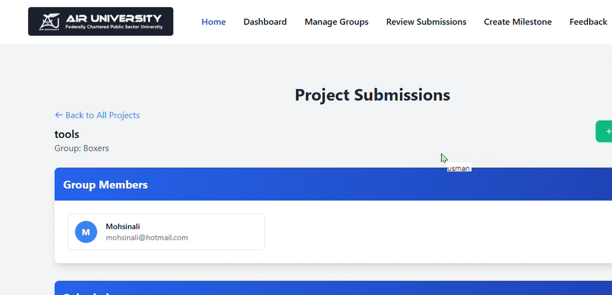
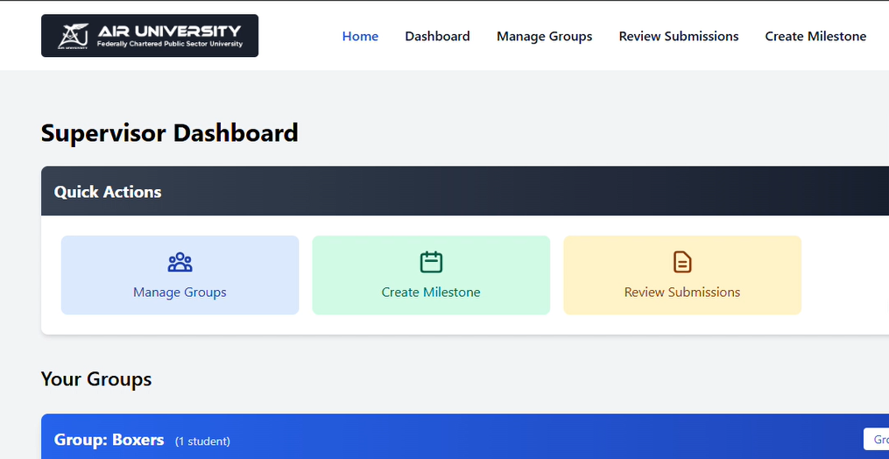
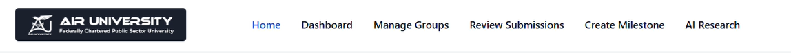
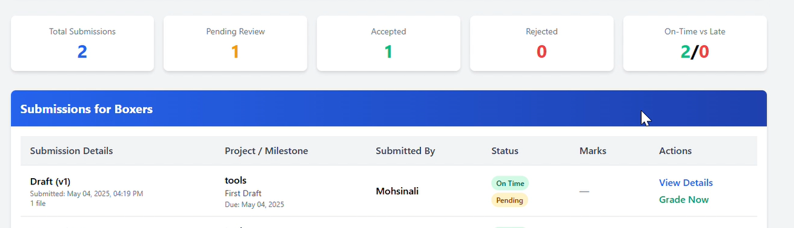

# Dissertation Management System

**A role-based, database-driven web application for managing university dissertation workflows.**

**Tech stack:** PHP · MySQL · HTML5 · CSS3 · JavaScript  
**Project type:** Bachelor of Science in Computer Science — Final Year Project (February–June 2025)

## Overview

The Dissertation Management System (DMS) brings dissertation-related activities into one application for **students, supervisors, and administrators**. Instead of managing submissions and reviews across disconnected processes, each role has a dedicated dashboard for its part of the academic workflow.

I developed this project to gain hands-on experience in full-stack web development, relational data modeling, PHP session management, and role-based application flows.

## Key Features

| Role | Main workflows |
| --- | --- |
| **Student** | Access a student dashboard, submit dissertation-related work, and follow submission or review status. |
| **Supervisor** | Access a supervisor dashboard, review submissions, and provide feedback. |
| **Administrator** | Access an administrative dashboard and manage academic users and dissertation workflows. |

The database schema also contains structures for projects, submissions, feedback, milestones, notifications, and student groups.

## Architecture and Implementation

- **Frontend:** HTML, CSS, and JavaScript for the application interface.
- **Server-side application:** PHP handles page requests and application logic.
- **Database:** MySQL stores user and project-related records in relational tables.
- **Session-based navigation:** The PHP entry point checks `$_SESSION['user_id']`, reads the authenticated user's role, and redirects to the corresponding dashboard.
- **Role-specific flows:** Student, Supervisor, and Admin have separate dashboard routes.

### Request flow

```text
Browser
   |
   v
PHP application (login and session handling)
   |
   +-- Student     --> Student dashboard
   +-- Supervisor  --> Supervisor dashboard
   +-- Admin       --> Admin dashboard
   |
   v
MySQL database (users, roles, projects, submissions, feedback, ...)
```

**Implementation note:** Redirecting users according to a session role is not, by itself, proof of full server-side authorization on every protected page. The complete source should be reviewed for authorization checks, password verification, input validation, and safe SQL query handling before production use.

## Getting Started (Local Development)

### Prerequisites

- A local PHP-enabled web server, such as **XAMPP** (Apache + PHP + MySQL)
- MySQL or MariaDB and a database administration tool such as phpMyAdmin
- The **complete application source**, including the `pages/` routes referenced by `index.php`

### Setup

1. Clone the repository:

   ```bash
   git clone https://github.com/moshinale/DissertationManagmentSystem.git
   ```

2. Copy the application into your local web-server document root (for example, `htdocs/DissertationManagmentSystem` in XAMPP).
3. Ensure the full PHP application is available. The repository currently includes `dms_project.rar`; some application pages referenced in `index.php` are not visible as individual files at the repository root. Extract the archive **if it contains those files**, preserving its directory structure.
4. Create a local MySQL database. Review the SQL dumps in the repository (including `project_db (2).sql`) and import the dump that matches the application version. Avoid importing multiple different dumps on top of one another without checking their contents.
5. Find the PHP database connection configuration in the complete application source and update the host, database name, username, and password for your local environment.
6. Start Apache and MySQL, then visit:

   ```text
   http://localhost/DissertationManagmentSystem/
   ```

**Setup status:** These are general local-development steps based on the publicly visible files; a complete clean-install test has not been verified. The application will not work correctly if its referenced PHP pages or database configuration are missing. Do not publish real credentials or private student data.

## Screenshots

Screenshots currently available in the repository:






## What I Learned

- Translating an academic workflow into distinct student, supervisor, and administrator views.
- Building server-side web functionality with PHP and integrating it with a relational MySQL schema.
- Using PHP sessions to manage authenticated navigation.
- Thinking about database relationships among users, projects, submissions, and feedback.

## Potential Improvements

- Make the full, organised PHP source available as browsable repository files instead of relying on an archive.
- Verify consistent server-side authorization checks and adopt current password-hashing, validation, and prepared-query best practices wherever needed.
- Add automated tests, documented local seed data, and reproducible setup instructions.
- Add a deployment guide and sanitised screenshots or demo data for reviewers.

## Author

**Mohsin Ali**  
BSc Computer Science — Air University, Islamabad (2025)  
[LinkedIn](https://www.linkedin.com/in/mohsin-ali-115520373/) · [GitHub](https://github.com/moshinale)  
Email: moxin.ali372@gmail.com

---

*Academic project. The README describes the project's confirmed technologies and the structure visible in its repository; it does not claim production deployment, verified security certification, or measured performance improvements.*
